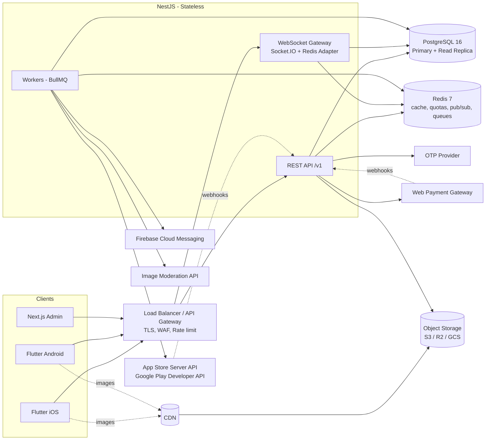

# 02 — System Architecture

## 1. نظرة عامة

## 2. المكونات

### 2.1 Mobile (Flutter)
- **State management:** Riverpod 2 (code-gen).
- **Routing:** go_router مع Guards حسب حالة الحساب.
- **Networking:** Dio + interceptors (JWT refresh، Accept-Language، idempotency).
- **Realtime:** socket_io_client.
- **Local storage:** flutter_secure_storage (tokens)، Drift/Hive (cache المحادثات).
- **Images:** cached_network_image + ضغط قبل الرفع (flutter_image_compress).
- **i18n:** flutter_localizations + ARB (ar, en) — `Directionality` تلقائي.
- **Payments:** in_app_purchase (StoreKit 2 / Play Billing 7+).
- **Push:** firebase_messaging + flutter_local_notifications.

> **ملاحظة:** تُثبَّت إصدارات المكتبات عند بدء المرحلة 3 بأحدث إصدار مستقر في ذلك الوقت (قاعدة Script 03).

### 2.2 Backend (NestJS)
وحدات (Modules) مستقلة بحدود واضحة — Modular Monolith قابل للتقسيم لاحقًا إلى خدمات:

| Module | المسؤولية |
|---|---|
| `auth` | OTP، JWT access/refresh، الأجهزة والجلسات |
| `users` | الحساب والحالة |
| `profiles` | الملف، التفضيلات، الاهتمامات |
| `media` | رفع الصور (Presigned URLs)، المعالجة، الفحص |
| `verification` | طلبات المراجعة والقرارات |
| `discovery` | محرك الترشيح والبحث |
| `swipes` | Like / Pass / Undo |
| `matches` | إنشاء الـ Match وإلغاؤه |
| `chat` | المحادثات والرسائل + Gateway |
| `quotas` | الحصص اليومية (Redis + DailyUsage) |
| `subscriptions` | الخطط، الاستحقاقات Entitlements |
| `payments` | تحقق الإيصالات، Webhooks، الاسترداد |
| `notifications` | FCM + صندوق الإشعارات |
| `safety` | البلاغات، الحظر، كشف الإزعاج والحسابات الوهمية |
| `support` | FAQ، تذاكر الدعم |
| `admin` | RBAC للمديرين، الإحصاءات، سجل التدقيق |
| `settings` | AppSettings الديناميكية مع cache |

### 2.3 Admin (Next.js)
- App Router + Server Components، TanStack Query، shadcn/ui مخصص بالهوية.
- مصادقة منفصلة (`AdminUser`) مع 2FA (TOTP) وRBAC.
- يتعامل مع `/v1/admin/*` فقط.

### 2.4 Workers (BullMQ)
- `media.process` — توليد أحجام (thumb 200, card 800, full 1600) بصيغة WebP، إزالة EXIF/GPS.
- `media.moderate` — فحص آلي ونتيجة مرفقة بطلب التوثيق.
- `subscriptions.reconcile` — مزامنة يومية مع المتاجر.
- `notifications.send` — دفعات FCM.
- `safety.scan` — كشف الأنماط المشبوهة.
- `accounts.purge` — حذف نهائي بعد فترة السماح.
- `discovery.precompute` — حساب درجات التوافق مسبقًا (اختياري للتوسع).

## 3. تدفق الرفع للصور

1. التطبيق يضغط الصورة ويطلب `POST /v1/media/photos/upload-url`.
2. الخادم يعيد Presigned PUT URL (صلاحية 5 دقائق، حجم أقصى 10MB، نوع MIME محدد).
3. التطبيق يرفع مباشرة للتخزين.
4. `POST /v1/media/photos/{id}/complete` → وضع مهمة `media.process` ثم `media.moderate`.
5. الصورة تبقى `PENDING` ولا تُعرض للآخرين حتى `APPROVED`.

## 4. الـ Realtime

- Socket.IO namespace `/chat`، مصادقة JWT في handshake.
- غرف: `user:{id}` و`conv:{id}`.
- Redis Adapter لدعم عدة نسخ.
- كل رسالة تحمل `clientMessageId` (UUID) → قيد فريد `(conversationId, senderId, clientMessageId)` يمنع التكرار.
- إن كان المستلم غير متصل → FCM.

## 5. البيئات

| البيئة | الغرض |
|---|---|
| `local` | Docker Compose |
| `dev` | تكامل مستمر |
| `staging` | اختبار المتاجر (Sandbox) |
| `production` | الإنتاج |

## 6. الاستضافة المقترحة

حاويات Docker على أي مزود (AWS ECS / GCP Cloud Run / Fly / Hostinger VPS) مع PostgreSQL مُدار وRedis مُدار. القرار النهائي يُسجَّل في ADR عند المرحلة 4.

## 7. المراقبة

- Logs منظمة JSON (pino) بدون بيانات شخصية.
- Sentry للأخطاء (موبايل + خادم + لوحة).
- OpenTelemetry + Prometheus/Grafana للمقاييس.
- Health checks: `/health/live`, `/health/ready`.
