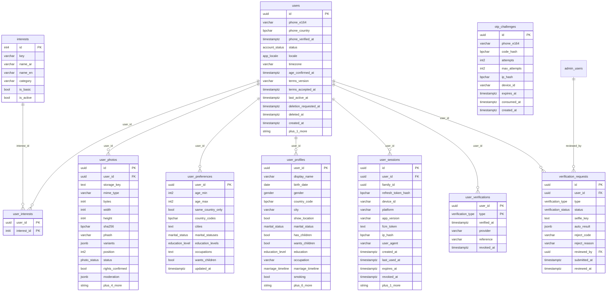
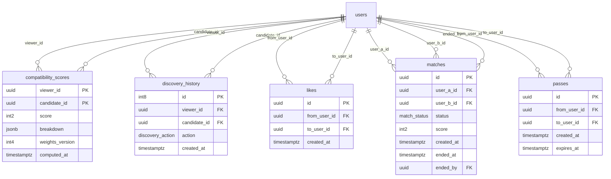
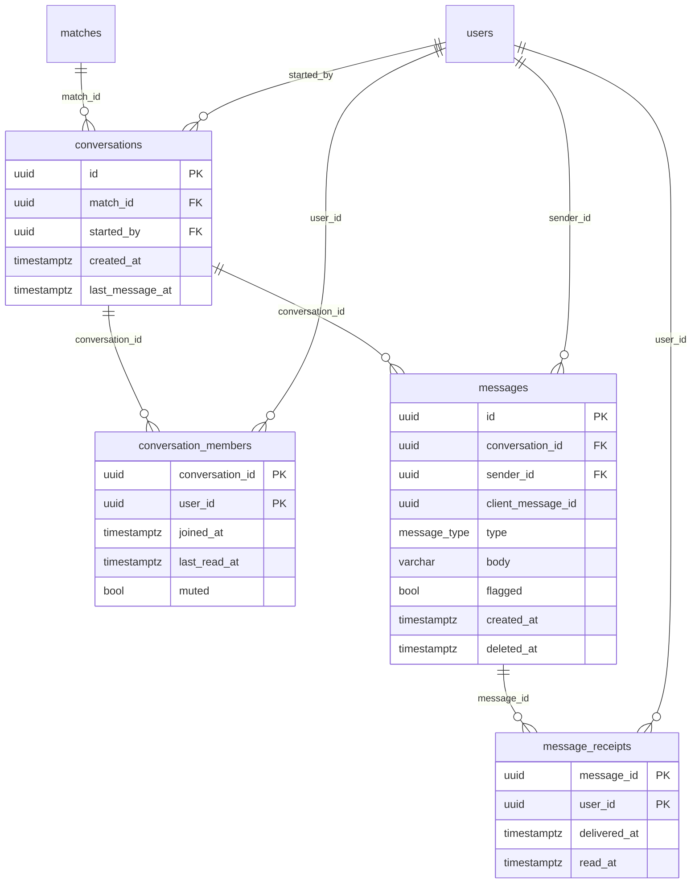
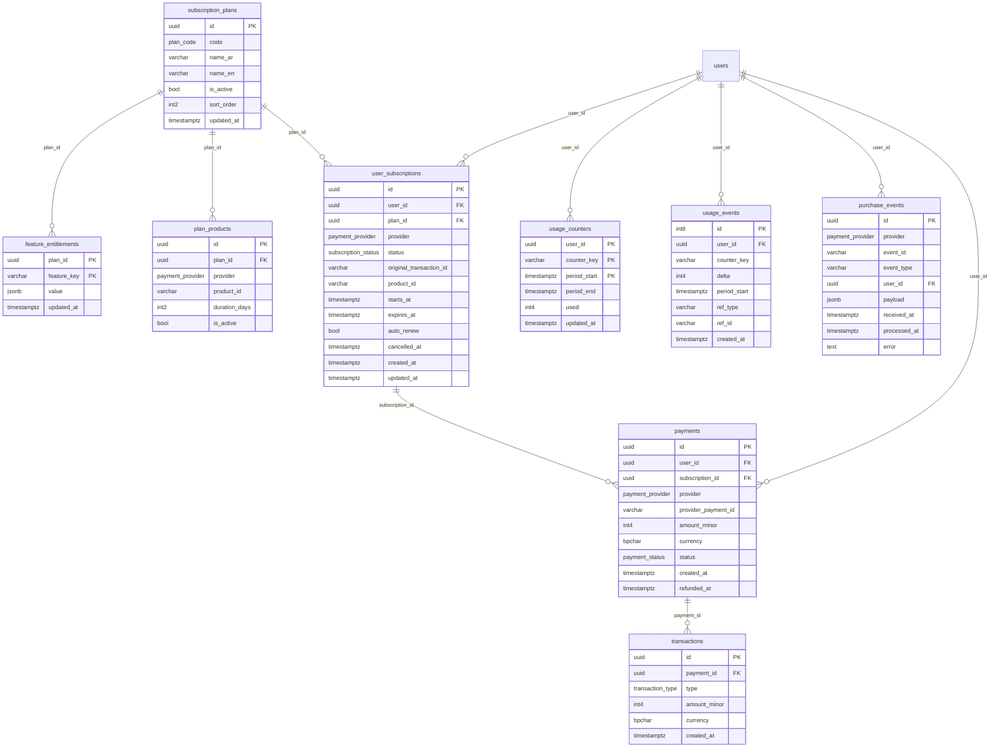
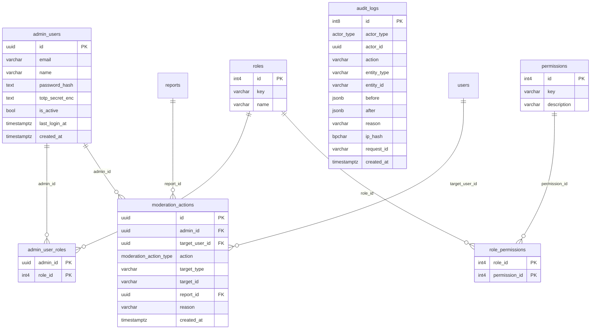
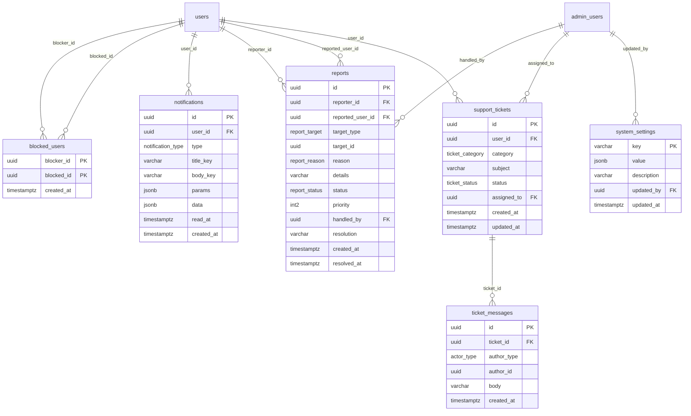

# 03 — Database ERD

Generated from the migrated PostgreSQL schema (`backend/prisma/migrations/20261114000000_init/migration.sql`) — 41 tables. Every table has a primary key; relations below are the real foreign keys.

## Key design decisions

| Concern | Mechanism |
|---|---|
| One live account per phone, soft delete | partial unique index `users_phone_live_uq … WHERE deleted_at IS NULL` |
| No duplicate likes / passes | `UNIQUE (from_user_id, to_user_id)` |
| One match per pair | `CHECK (user_a_id < user_b_id)` + `UNIQUE (user_a_id, user_b_id)` |
| Race-free mutual match | `olfa_like()` takes a per-pair advisory lock inside one transaction |
| Quotas that cannot be exceeded concurrently | `olfa_consume_quota()` — `INSERT … ON CONFLICT DO UPDATE … WHERE used < limit` |
| Quota windows | `usage_counters.period_start/end` = user-local midnights stored as UTC; append-only `usage_events` ledger |
| Idempotent chat send | `UNIQUE (conversation_id, sender_id, client_message_id)` |
| OTP never stored in clear | `otp_challenges.code_hash` = HMAC-SHA256(secret, phone:code) |
| Refresh-token rotation + reuse detection | `user_sessions.family_id`, `refresh_token_hash` (SHA-256) |
| Photo rights acknowledgement | `CHECK (rights_confirmed)` on `user_photos` |
| One open review per user | partial unique index on `verification_requests (user_id, type) WHERE status = 'PENDING'` |

## Identity & profile

## Discovery & matching

## Messaging

## Commercial

## Administration

## Support & safety

